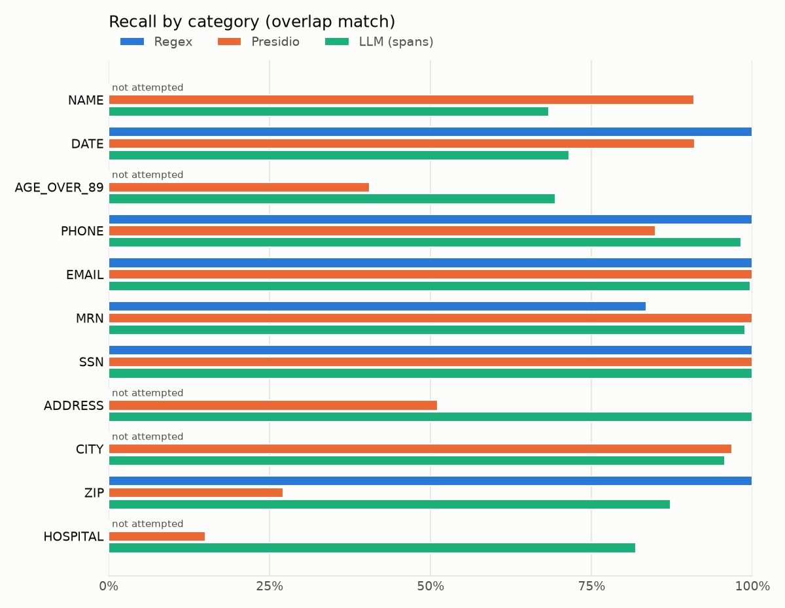

# scrubbed

A small, local-only benchmark: how well do **regex**, **Presidio**, and a **local LLM (Ollama)** find and remove patient identifiers in clinical notes, and does the LLM change anything it shouldn't?

All notes are synthetic. Nothing is sent to an external API; the Ollama client refuses non-localhost URLs. This is a benchmark, **not** a compliance tool, and nothing here claims HIPAA compliance.

## Results

200 synthetic notes, 2,803 identifiers. Overlap matching, label-agnostic. LLM = qwen2.5:7b-instruct (Q4) on an M5 Pro laptop, mean of 3 runs. Full tables: [article_assets/results.md](article_assets/results.md). Interactive report (filters, tooltips, table views, and a note explorer for all 200 notes): [article_assets/report.html](article_assets/report.html). It is a single offline file.

| Method | Precision | Recall | F1 (overlap) | F1 (exact) | Runtime / note |
|---|---|---|---|---|---|
| Regex | 96.5 | 42.9 | 59.4 | 59.4 | 0.1 ms |
| Presidio | 74.1 | 79.2 | 76.5 | 66.1 | 19 ms |
| LLM (spans) | 77.9 | 79.7 | 78.8 ± 0.6 | 59.6 | 5.0 s |
| LLM (spans, temp 0) | 77.3 | 80.1 | 78.7 | 60.0 | 5.2 s |
| LLM (rewrite) | – | ~61 (approx.) | – | – | 5.5 s |



**What the numbers say**

- **Overall, Presidio and the LLM are about even (F1 76.5 against 78.8), but the LLM is about 260× slower.** They fail in different places. Presidio is strong on names (91% recall), but finds 15% of hospitals and 27% of ZIPs (no ORG or ZIP recognizer by default), and thinks "daily" is a date and "MD" is Maryland. The LLM finds hospitals (82%), addresses (100%) and ZIPs (87%), but recalls only 68% of names.
- **Most LLM name misses are a code problem.** The model returns "Alexander, Tracy" once and never "Alexander" alone, so "Ms. Alexander" survives. Redacting each word of a returned name everywhere lifts name recall to about 88% and overall F1 to about 0.83, with no extra eponym false positives. This fix was found after looking at the results, so it isn't in the headline numbers.
- **Regex is precise and blind.** 100% recall on the formats it knows (it was written alongside the templates, so that's an upper bound) and 0% on names, addresses, cities, hospitals and old ages. Its only false positives are motor strength scores ("4/5").
- **Eponym traps:** Presidio redacted 32% of terms like "Cushing syndrome", "Foley catheter" and "Glasgow Coma Scale" (Glasgow as a city). The LLM redacted 22% (mostly "Raynaud phenomenon" and "Down syndrome" labeled as DATE).
- **The LLM is not consistent.** At default sampling, only 8% of notes got the same spans in all 3 runs, and 446 identifiers were found in only 1 or 2 of the 3 runs. Temperature 0 didn't improve accuracy (F1 78.7). With JSON-schema output there were 0 timeouts and 1 invalid JSON in 800 extraction calls, plus 10–29 items per run that weren't in the note.
- **Content integrity:** span methods only ever delete text. Presidio and LLM spans over-redact heavily: non-identifier words were lost in 88% and 84% of notes. The LLM labeled doses as dates, so medication text was lost in 30% of notes. **Asking the LLM to rewrite the note is worse.** It leaks far more (approximate recall 61%), inserts about 3 words per note, rewords labels, invents a `[MEDICATION]` tag, and returned 7/200 notes in capitals. Let the model point at spans and let code redact.

## How to run

Requires Python 3.11, [uv](https://github.com/astral-sh/uv), and [Ollama](https://ollama.com) running locally.

```bash
make setup                       # venv, dependencies, spaCy en_core_web_lg (~400 MB)
ollama pull qwen2.5:7b-instruct  # default local model
make test

make data        # 200 synthetic notes + gold spans -> data/notes.jsonl
make regex       # predictions -> data/predictions/
make presidio
make llm         # 3 runs per note (~50 min on an M5 Pro; cached in data/llm_cache/)
make llm-t0      # 1 run at temperature 0
make rewrite     # LLM rewrites each note with identifiers redacted (~20 min)
make report      # tables + charts + report.html -> article_assets/
```

`make all` runs everything. LLM responses are cached, so re-running is fast and gives the same numbers. Delete `data/llm_cache/` to sample again.

### Configuration

| Env var | Default | Purpose |
|---|---|---|
| `DEID_OLLAMA_URL` | `http://localhost:11434` | Must be localhost |
| `DEID_OLLAMA_MODEL` | `qwen2.5:7b-instruct` | Any local Ollama model |
| `DEID_OLLAMA_NUM_CTX` | `8192` | Context window, set explicitly so long notes aren't silently truncated |
| `DEID_OLLAMA_TIMEOUT_S` | `120` | Per-request timeout (a timeout counts as a failure) |
| `DEID_LLM_TEMPERATURE` | unset (Ollama default) | Sampling temperature for `make llm` |
| `DEID_PRESIDIO_THRESHOLD` | `0` | Presidio score threshold (its default) |
| `DEID_SEED` | `1234` | Seed for synthetic data |
| `DEID_N_NOTES` | `200` | Number of synthetic notes |

Tested with Faker 40.53, presidio-analyzer 2.2.366, spaCy 3.8 and Ollama 0.40. A different Faker version can produce a different corpus from the same seed.

## What's measured

- **Data:** 200 notes across 6 types (discharge summary, progress note, referral letter, ED note, lab follow-up, phone message), with 2,803 identifiers in 11 categories (a subset of HIPAA Safe Harbor): NAME, DATE, AGE_OVER_89, PHONE, EMAIL, MRN, SSN, ADDRESS, CITY, ZIP, HOSPITAL. Gold spans are recorded while each note is rendered, so they are correct by construction. The notes include lowercase names, names that are ordinary words (Hope, Will, Rose, Bell), 8 date formats, labeled and unlabeled MRNs, and 190 **trap terms**: clinical terms that contain a person's name but aren't identifiers (Parkinson's disease, Down syndrome, Hodgkin lymphoma, Foley catheter, Apgar score...).
- **Detection:** precision, recall and F1, overall and per category, with **exact** (same offsets) and **overlap** (any shared character) matching. Matching ignores the predicted label, because what matters is whether the identifier was removed. Label agreement is reported separately, along with **partial leaks** (found, but part of the text survives).
- **Methods:**
  1. **Regex:** phone, email, SSN, labeled MRN, dates, ZIP after a state code. Names aren't attempted.
  2. **Presidio:** default recognizers plus a custom MRN recognizer, default threshold. Entity mapping in `src/deid/methods/presidio.py` (`ENTITY_MAP`).
  3. **Local LLM:** qwen2.5:7b-instruct via Ollama with a JSON schema. The model returns each identifier's text and category, and code finds every occurrence in the note. Invalid JSON, text not in the note, timeouts and truncation are counted as failures. Each note runs 3 times to measure consistency.
- **Content integrity:** every method's redacted note is diffed against the original with gold identifiers removed. "LLM finds spans, code redacts" is compared with "LLM rewrites the note with tags".

## Design decisions

The full list, with reasons, is in [DECISIONS.md](DECISIONS.md). The ones that most affect the numbers:

- Detection is label-agnostic; overlap matching is the headline number, and exact matching is reported next to it.
- Every method keeps its out-of-the-box settings: Presidio's default threshold and spaCy model, Ollama's default sampling. One extra LLM run at temperature 0 is included for comparison.
- The LLM prompt states general rules (eponyms aren't names, a year alone isn't a date, ages ≤ 89 aren't identifiers) but never lists the trap terms. Presidio can't be given rules like that; that's part of the comparison.
- Overlapping predictions are merged into their union, so redaction never leaves half of an identifier.
- A failed LLM call means "predicted nothing" for that note, never "skip the note".

## Limitations

- **Synthetic, template-based notes are much cleaner than real ones.** Six templates, one writing style, no typos, no copy-forward, no tables. Every method will do worse on real notes.
- **The regex baseline is optimistic.** It was written by the same author as the templates, so it knows every format. Its near-perfect recall on pattern categories shows its ceiling, not what to expect on real notes.
- **One local model** (a 4-bit 7B). Larger models, or other prompts, would score differently.
- **English and US formats only.**
- **200 notes:** small categories (AGE_OVER_89: 37 spans, SSN: 51) have wide error bars.
- **The rewrite approach's recall is approximate** (an identifier counts as leaked if its text is still in the output).
- **Not a compliance tool.** Safe Harbor has 18 identifier types; this covers 11. Nothing here should be used to de-identify real patient data.

## Next steps

- **Date shifting instead of redaction:** keep intervals (day 3 of admission) clinically useful.
- **Combine Presidio and the LLM.** Use Presidio for pattern categories and as a cheap first pass, and the LLM for names, hospitals and context.
- **Evaluate on real de-identification datasets** (e.g. the i2b2/n2c2 de-identification corpora or PhysioNet's deid notes), which require a data use agreement.

## Layout

```
src/deid/
  generate.py       synthetic notes + gold spans
  evaluate.py       precision / recall / F1, exact + overlap, misses, trap hits
  methods/          regex.py, presidio.py, llm.py
  ollama_client.py  local-only client, cache, failure kinds
  integrity.py      LLM rewrite + content diff
  results.py        tables, charts, results.json
  report.py         article_assets/report.html (data + report_assets/ JS and CSS, inlined)
tests/              pytest (no network: the LLM is mocked)
article_assets/     results.md, CSVs, charts, report.html
DECISIONS.md        non-obvious choices
NOTES.md            surprises along the way
```
