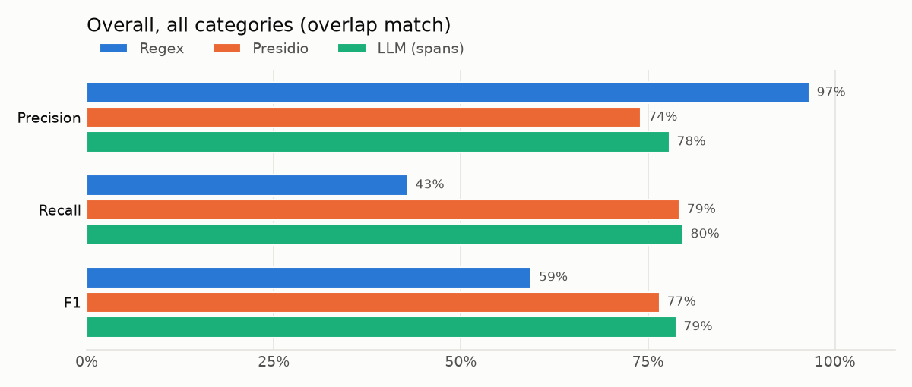
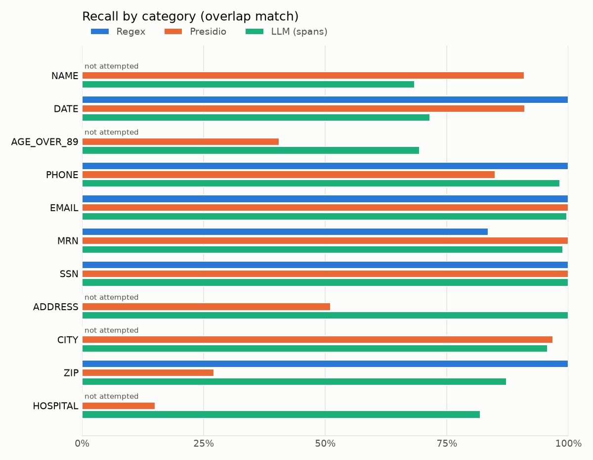
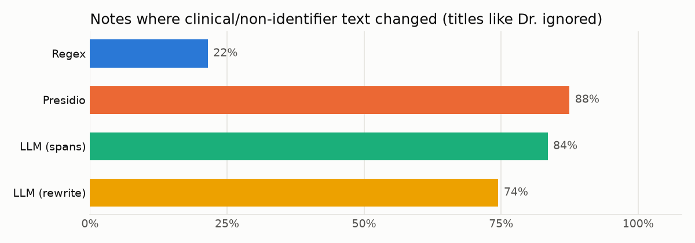

# Results

200 synthetic notes, 2803 gold identifiers. Recall/precision ignore the predicted label (did the identifier get removed?). Overlap = any shared character; exact = same start and end. LLM numbers are the mean of 3 runs (± = standard deviation across runs).

## Overall

| Method | Precision | Recall | F1 (overlap) | F1 (exact) | Partial leaks | Label agreement | Runtime / note |
|---|---|---|---|---|---|---|---|
| Regex | 96.5 | 42.9 | 59.4 | 59.4 | 0 | 100.0 | 0.1 ms |
| Presidio | 74.1 | 79.2 | 76.5 | 66.1 | 177 | 90.8 | 19.2 ms |
| LLM (spans) | 77.9 | 79.7 | 78.8 ± 0.6 | 59.6 | 13 | 92.9 | 5.0 s |
| LLM (spans, temp 0) | 77.3 | 80.1 | 78.7 | 60.0 | 11 | 93.5 | 5.2 s |

*Partial leaks*: identifiers found but not fully covered (part of the text survives redaction). *Label agreement*: share of found identifiers given the right category.

## Recall and precision by category (overlap)

| Category | Gold | Regex R | Regex P | Presidio R | Presidio P | LLM (spans) R | LLM (spans) P | LLM (spans, temp 0) R | LLM (spans, temp 0) P |
|---|---|---|---|---|---|---|---|---|---|
| NAME | 975 | 0.0 | – | 90.9 | 87.8 | 68.3 | 97.6 | 68.1 | 98.5 |
| DATE | 602 | 100.0 | 93.3 | 91.0 | 55.3 | 71.5 | 52.6 | 73.6 | 51.5 |
| AGE_OVER_89 | 37 | 0.0 | – | 40.5 | – | 69.4 | 21.4 | 81.1 | 24.4 |
| PHONE | 166 | 100.0 | 100.0 | 84.9 | 98.6 | 98.2 | 92.2 | 97.6 | 97.7 |
| EMAIL | 84 | 100.0 | 100.0 | 100.0 | 100.0 | 99.6 | 99.6 | 100.0 | 100.0 |
| MRN | 200 | 83.5 | 100.0 | 100.0 | 100.0 | 98.8 | 85.0 | 99.5 | 83.9 |
| SSN | 51 | 100.0 | 100.0 | 100.0 | 100.0 | 100.0 | 79.1 | 100.0 | 62.2 |
| ADDRESS | 133 | 0.0 | – | 51.1 | – | 100.0 | 98.6 | 99.2 | 99.4 |
| CITY | 156 | 0.0 | – | 96.8 | 58.4 | 95.7 | 97.2 | 95.5 | 97.3 |
| ZIP | 133 | 100.0 | 100.0 | 27.1 | – | 87.2 | 97.8 | 88.0 | 96.9 |
| HOSPITAL | 266 | 0.0 | – | 15.0 | – | 81.8 | 87.3 | 80.8 | 86.7 |

## Hard slices (recall, overlap)

| Slice | n | Regex | Presidio | LLM (spans) |
|---|---|---|---|---|
| NAME: common-word (Hope, Will, Rose...) | 318 | 0.0 | 80.2 | 71.1 |
| NAME: lowercase | 86 | 0.0 | 76.7 | 57.0 |
| NAME: other | 595 | 0.0 | 96.8 | 68.4 |
| NAME: patient | 367 | 0.0 | 88.0 | 62.7 |
| NAME: relative | 175 | 0.0 | 90.9 | 70.9 |
| NAME: clinician | 433 | 0.0 | 93.3 | 71.6 |
| MRN: labeled | 167 | 100.0 | 100.0 | 98.8 |
| MRN: unlabeled | 33 | 0.0 | 100.0 | 100.0 |
| DATE: no year (Mar 4, 3/4) | 162 | 100.0 | 66.7 | 56.2 |

## Eponym traps (false positives)

Clinical terms containing a person's name (Parkinson's disease, Down syndrome, Foley catheter, Apgar score...). Share of trap terms that a method redacted:

| Method | Trap terms flagged | Most often flagged |
|---|---|---|
| Regex | 0.0% | – |
| Presidio | 32.1% | Cushing syndrome (14), Foley catheter (12), Guillain-Barre syndrome (10), Glasgow Coma Scale (10) |
| LLM (spans) | 21.6% | Raynaud phenomenon (18), Down syndrome (13), Parkinson's disease (13), Bell's palsy (11) |
| LLM (spans, temp 0) | 24.2% | Raynaud phenomenon (7), Down syndrome (6), Parkinson's disease (5), Addison's disease (4) |

## Top missed identifiers (run 0, overlap)

### Regex

- **NAME**: 975 missed, e.g. `y Hospital of Tulsa  Patient: <<Alexander, Tracy>>    Med Rec #01962099 DOB: 04/`
- **HOSPITAL**: 266 missed, e.g. `DISCHARGE SUMMARY <<University Hospital of Tulsa>>  Patient: Alexander, Tracy   `
- **CITY**: 156 missed, e.g. ` Address: 53000 Wong Orchard, <<Durham>>, NC 27077  Discharge Medicati`
- **ADDRESS**: 133 missed, e.g. `er Hanna.  Discharge Address: <<53000 Wong Orchard>>, Durham, NC 27077  Discharge `
- **AGE_OVER_89**: 37 missed, e.g. `t: Lynn Torres (83352547)  S: <<102>> yo F seen for follow-up of Gr`

### Presidio

- **HOSPITAL**: 226 missed, e.g. `DISCHARGE SUMMARY <<University Hospital of Tulsa>>  Patient: Alexander, Tracy   `
- **ZIP**: 97 missed, e.g. `3000 Wong Orchard, Durham, NC <<27077>>  Discharge Medications: - ome`
- **NAME**: 89 missed, e.g. `r if worse. Will route to Dr. <<Love>>.  Taken by: Chase, RN`
- **ADDRESS**: 65 missed, e.g. `    SSN: 476-06-9226 Address: <<5977 Krista Mountains Apt. 787>>, Durham, NC 27796 Emergency c`
- **DATE**: 54 missed, e.g. `: 548-20-8186 Admission Date: <<Sep 9>>    Discharge Date: 9/13 Atten`

### LLM (spans)

- **NAME**: 311 missed, e.g. `story of Present Illness: Ms. <<Alexander>> is a 30-year-old woman with a`
- **DATE**: 169 missed, e.g. `SN: 008129540 Admission Date: <<2019-05-22>>    Discharge Date: May 24 Att`
- **HOSPITAL**: 44 missed, e.g. `DISCHARGE SUMMARY <<Eugene Regional Medical Center>>  Patient: Hill, Robin    MRN:`
- **ZIP**: 15 missed, e.g. `urnpike Suite 169, Fresno, CA <<94597>> Emergency contact: Hope Rhode`
- **AGE_OVER_89**: 10 missed, e.g. `t: Lynn Torres (83352547)  S: <<102>> yo F seen for follow-up of Gr`

## Most frequent false positives (run 0)

- **Regex**: `4/5` as DATE (22), `5/5` as DATE (21)
- **Presidio**: `daily` as DATE (134), `MD` as CITY (73), `ED` as NAME (48), `3 months` as DATE (34), `SpO2` as NAME (33), `RN` as CITY (30)
- **LLM (spans)**: `asthma` as DATE (9), `Raynaud phenomenon` as DATE (8), `atrial fibrillation` as DATE (8), `2013` as DATE (7), `amlodipine 5 mg daily` as DATE (7), `major depressive disorder` as DATE (7)

## LLM reliability

- Runs: 3 per note at Ollama's default sampling. Notes with an identical set of spans in every run: 17/200 (8%). Mean pairwise Jaccard of span sets: 0.674.
- Gold identifiers found in k of 3 runs: 0: 353, 1: 203, 2: 243, 3: 2004
- Failures per run: run 0: not_in_note=16; run 1: not_in_note=17; run 2: not_in_note=29
- Items the model returned that are not in the note (examples): 'andrea, white', '06/28/20', '11/9/2023', '225-974-0619', '0.7', '3/26'
- Largest prompt: 781 tokens (num_ctx 8192, so no truncation).
- Post-hoc (not the headline method): also redacting each word of every returned NAME raises name recall 68.3 -> 88.4 and F1 78.8 -> 82.8; trap hits per run 41 -> 41.
- Same prompt at temperature 0 (1 run): precision 77.3, recall 80.1, F1 78.7.

## Content integrity

Each redacted note is compared with the original minus its gold identifiers. Any other word that disappears, changes or appears counts. For the span methods this can only come from over-redaction; the rewrite can change anything.

| Method | Notes changed | Changed, ignoring Dr/Mr/Ms/MD/RN | Numbers changed | Medications changed | Words dropped / note | Words inserted / note |
|---|---|---|---|---|---|---|
| Regex | 21.5% | 21.5% | 21.5% | 0.0% | 0.21 | 0.00 |
| Presidio | 92.0% | 87.5% | 66.5% | 0.0% | 6.59 | 0.06 |
| LLM (spans) | 94.5% | 83.5% | 54.5% | 30.0% | 10.37 | 0.01 |
| LLM (rewrite) | 78.0% | 74.5% | 12.0% | 2.0% | 4.25 | 3.04 |

Rewrite approach: approximate recall 61.1% (identifier text no longer present), 5.5 s/note, failures: none. Notes returned mostly in CAPITALS: 7/200.

**Regex** examples (reference -> output):

- `note_0003`: `room air Exam strength 5/5 in the left upper  ->  room air Exam strength in the left upper`
- `note_0007`: `room air Exam strength 5/5 in the left upper  ->  room air Exam strength in the left upper`
- `note_0013`: `room air Exam strength 5/5 in the left upper  ->  room air Exam strength in the left upper`

**Presidio** examples (reference -> output):

- `note_0000`: `DOB Age 30 SSN Admission Date Discharge Date Attending  ->  DOB Age 30 SSN Date Discharge Date Attending`
- `note_0001`: `Diagnosed with asthma in 2013 O BP 135/92 HR  ->  Diagnosed with asthma in O RR 16 T`
- `note_0002`: `for seeing Ms a 69 year old woman whom I am  ->  for seeing Ms a woman whom I am`

**LLM (spans)** examples (reference -> output):

- `note_0001`: `NOTE Pt MRN S 51 yo F seen for follow up  ->  NOTE Pt MRN S seen for follow up`
- `note_0005`: `TELEPHONE ENCOUNTER Re pt 45 yo Caller son callback Msg  ->  TELEPHONE ENCOUNTER Re pt Caller Miles Lyons son`
- `note_0006`: `Patient MRN DOB Age 50 SSN Admission Date Discharge  ->  Patient MRN DOB Age SSN Admission Date Discharge`

**LLM (rewrite)** examples (reference -> output):

- `note_0001`: `PROGRESS NOTE Pt MRN S 51 yo F  ->  PROGRESS NOTE 2/23 Pt S 51 yo F`
- `note_0002`: `Re DOB MR Address SC Dear Dr Thank you  ->  04/21/1953 MR 21097750 Address Dear Dr Nelson Thank`
- `note_0005`: `TELEPHONE ENCOUNTER Re pt 45 yo Caller son callback Msg  ->  TELEPHONE ENCOUNTER Re pt Caller son callback Msg`
